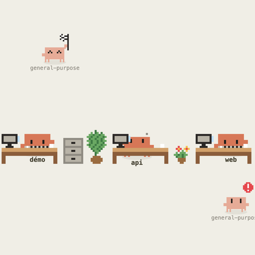
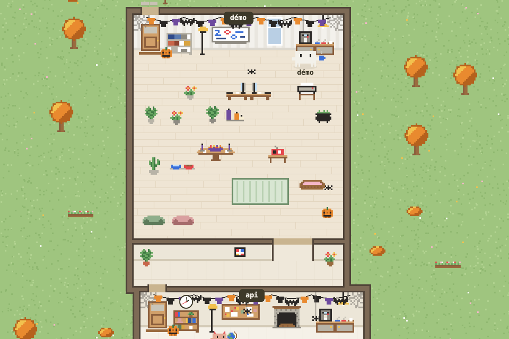

# clawd-pwa

A small pixel art office where each Claude Code agent shows up as a Clawd, the Claude Code mascot.
A Clawd types on its keyboard while its agent works, raises a flag when it is waiting for your
answer, and wanders around, plays or naps when it has nothing to do.

<p align="center">
  
</p>

Above is the simplest setup: one desk per session (`démo`, `api`, `web`). The three main agents are
working; the small, lighter Clawds are subagents waiting for an answer, one with its flag, the
other with its speech bubble.

Everything runs locally: a Claude Code hook, a tiny dependency-free Node server and a PWA you
install from Chrome. The hook doesn't slow your prompts down and costs no tokens (details below).

The interface is in French. Menu labels below are given as they appear on screen, with a
translation.

## What you see

- **One Clawd per open Claude Code session**, named after the folder it was started in (you can
  rename it from its card). Subagents appear as smaller, lighter Clawds next to their main agent.
- **What the agent is actually doing**: it types for an edit or a command, browses the bookshelf
  for a read or a search, spins the globe for the web, stands at the whiteboard when it thinks or
  plans. It waves a flag when it waits for a permission or an answer, jumps under a red cross when
  a tool fails, celebrates a commit and reacts to green or red tests. During a context compaction,
  it feeds its notes to the shredder.
- **Office life between tasks**: coffee at the counter (and a chat for two), passing a ball, sword
  fights, dancing by the radio, naps on a beanbag, a high five when a colleague finishes. A cat
  roams around, sleeps on the bookshelves and keeps company to whoever is waiting.
- **A living backdrop**: rooms laid out as a floor plan or a shared open space, an outside view
  (city, village, countryside, seaside or spaceship), real sunrise and sunset times, the current
  weather at the windows, seasons and holidays (Halloween, Christmas, Easter, national days, plus a
  few Luxembourg traditions such as the Schueberfouer or Buergbrennen), with decorations and
  costumes.
- **What needs you**: the tab title and the app icon badge count the agents waiting for input.
  Optionally, a system notification when an agent starts waiting while the PWA is in the
  background.

From there, a lot can be customized: full office, outside view, pixel size, season… (see
[Usage](#usage)).



Clicking a Clawd opens its card: folder, state, current tool, since when, subagents, last error.

## How it works

```
Claude Code ──hook──> hooks/clawd-hook.sh ──POST /event──> server.js ──SSE──> PWA (canvas)
                       (in the background)                  127.0.0.1:4777
```

1. Claude Code fires [hooks](https://docs.claude.com/en/docs/claude-code/hooks) at each step of a
   session: `SessionStart`, `UserPromptSubmit`, `PreToolUse`, `PostToolUse`,
   `PostToolUseFailure`, `PermissionRequest`, `Notification`, `Stop`, `SubagentStart`,
   `SubagentStop`, `PreCompact`, `PostCompact`, `SessionEnd`.
2. `hooks/clawd-hook.sh` reads the event's JSON payload from standard input and sends it to the
   local server with `curl`.
3. `server.js` turns these events into a state per agent (`working`, `waiting`, `idle`, with the
   current activity and tool) and streams a snapshot to the PWA with Server-Sent Events.
4. The PWA draws the scene on a canvas. All sprites are pixel grids drawn in code
   (`public/sprites.js`); no image is loaded.

### No slowdown

The hook is declared `async` in `settings.json`: Claude Code starts it and moves on without
waiting for it. The script itself returns in about ten milliseconds, because the request to the
server runs in the background with its streams closed and a one-second timeout. If the server is
stopped, slow or missing, nothing changes for Claude Code: `curl` fails silently and the hook
always exits with code 0.

### No extra tokens

Tokens come from what the model reads. A hook adds nothing to the context as long as it writes
nothing to standard output, and this one writes nothing: empty output, exit code 0. The model
doesn't even know the PWA exists. The server and the PWA call no Claude API; they only display what
the hooks send them.

### What leaves your machine

Nothing about your sessions. The server only listens on `127.0.0.1`, and the payloads (which
contain your prompts and tool inputs in plain text) are never written to disk, unless you turn on
the debug log (`CLAWD_LOG=1`, see below). The only outside request is for the weather: the PWA
queries [Open-Meteo](https://open-meteo.com) (no key needed) every 30 minutes with the coordinates
set in `public/weather.js`.

## Installation

Requirements: macOS or Linux, [Node.js](https://nodejs.org) 18 or later, `curl`, Python 3 for the
install scripts, and Chrome (or another Chromium browser) for the PWA. No npm dependencies.

```sh
git clone https://github.com/mattdaco-dev/clawd-pwa.git
cd clawd-pwa
```

### 1. Start the server

On macOS, as a service that starts when you log in and restarts if it crashes:

```sh
python3 scripts/install-service.py
```

The script writes the absolute path of `node` into a launchd agent
(`~/Library/LaunchAgents/local.clawd-pwa.plist`), because launchd doesn't see nvm. Run it again
after changing Node versions. The server log is in `logs/server.log`.

On Linux, or to try it without a service:

```sh
npm start
```

The default port is 4777. Change it with `CLAWD_PORT` (set it in Claude Code's environment too so
the hook follows).

### 2. Plug in the hook

```sh
python3 scripts/install-hooks.py
```

The script adds the hook to `~/.claude/settings.json` for every event listed above, without
touching your other hooks. It backs the file up first (`settings.json.bak-clawd-<date>`) and can be
run again without creating duplicates. Sessions already open pick up the hook without a restart.

### 3. Install the PWA

Open <http://localhost:4777> in Chrome, then click "Install app" in the address bar (or menu ⋮ >
Cast, save and share > Install page as app). Start a Claude Code session: its Clawd walks in.

### Uninstall

```sh
python3 scripts/install-hooks.py --uninstall
python3 scripts/install-service.py --uninstall
```

Then uninstall the PWA from Chrome.

## Usage

The round button at the top left opens the menu:

- **Live**: your real sessions.
- **Démo** (demo): three made-up sessions looping through a script, no Claude Code needed. Its bar
  lets you try everything: backdrop, layout, outside view, pixel size, time, weather, season,
  adding Clawds and subagents, forcing a state, tool errors, random picks.
- **Galerie** (gallery): every animation, grouped by activity.
- **Détacher le Live** (detach Live): the scene moves into a Picture-in-Picture window that stays
  on top of other windows and shrinks down to 240 px wide, handy to keep in a corner of the screen.

Menu settings are saved in the browser:

- **Décor** (backdrop): "Aucun" (none: just the Clawds, optionally with a desk each) or "Avec"
  (with: the full office).
- **Disposition** (layout): one room per session, as a floor plan with corridors and doorways, or a
  shared open space where everyone shares the desks.
- **Extérieur** (outside): a different world each day, a fixed world, or none.
- **Taille des pixels** (pixel size): from 1 to 6.
- **Notifications** when an agent is waiting.

### URL parameters

To see the backdrop in other conditions without waiting:

| Parameter | Values |
| --- | --- |
| `?heure=` (hour) | an hour from 0 to 23, for example `?heure=22` for night |
| `?meteo=` (weather) | `soleil` (sun), `nuages` (clouds), `brouillard` (fog), `pluie` (rain), `neige` (snow), `orage` (storm) |
| `?saison=` (season) | `printemps` (spring), `ete` (summer), `automne` (autumn), `hiver` (winter), `halloween`, `noel` (Christmas), `paques` (Easter), `nouvel-an` (New Year), `fouer`, `fuesend`, `buergbrennen`, `kleeschen`, `fete-lu`, `fete-fr`, `fete-be`, `fete-de` (national days of Luxembourg, France, Belgium, Germany) |

### Your city

Weather, sunrise and sunset are computed for Luxembourg. For your own city, change `LAT` and `LON`
in `public/weather.js`.

### Debug log

With `CLAWD_LOG=1` in Claude Code's environment, the hook keeps a raw copy of every payload in
`logs/events.jsonl` (5 MB max, then rotated). Off by default, since these payloads contain your
prompts in plain text.

## Code layout

| File | Role |
| --- | --- |
| `hooks/clawd-hook.sh` | The hook: forwards the payload to the server, in the background. |
| `server.js` | Turns events into a state per agent and streams it over SSE. Also serves the PWA. |
| `scripts/install-hooks.py` | Adds or removes the hook in `~/.claude/settings.json`. |
| `scripts/install-service.py` | Installs or removes the launchd service (macOS). |
| `public/app.js` | Menu, settings, views, notifications, Picture-in-Picture window. |
| `public/live.js` | The scene: Clawd behavior, multiplayer games, agent card. |
| `public/sprites.js` | Every Clawd animation, as pixel grids. |
| `public/office.js` | The indoor backdrop: rooms, open space, furniture, desks. |
| `public/outdoors.js` | The outside views. |
| `public/seasons.js`, `public/costumes.js` | Seasonal decorations, holidays and costumes. |
| `public/sun.js`, `public/weather.js` | Sunrise and sunset, weather. |
| `public/cat.js` | The cat. |
| `public/demo.js` | The Démo's made-up sessions and its settings bar. |

## Credits

Fan project, unofficial and not affiliated with Anthropic. Clawd and Claude Code belong to
Anthropic; the sprites in this repository are redrawn by hand in pixel art.

## License

Code released under the [MIT](LICENSE) license. It covers the code and the redrawn sprites in this
repository, not the Clawd character or Anthropic's trademarks.
